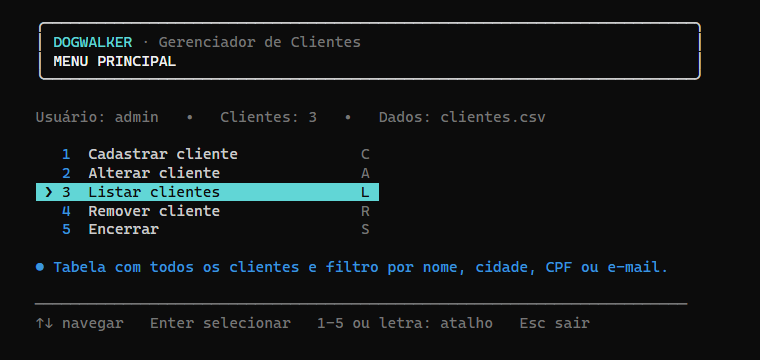
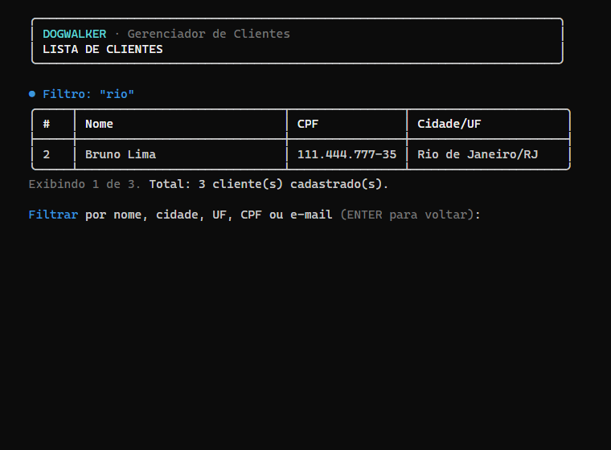
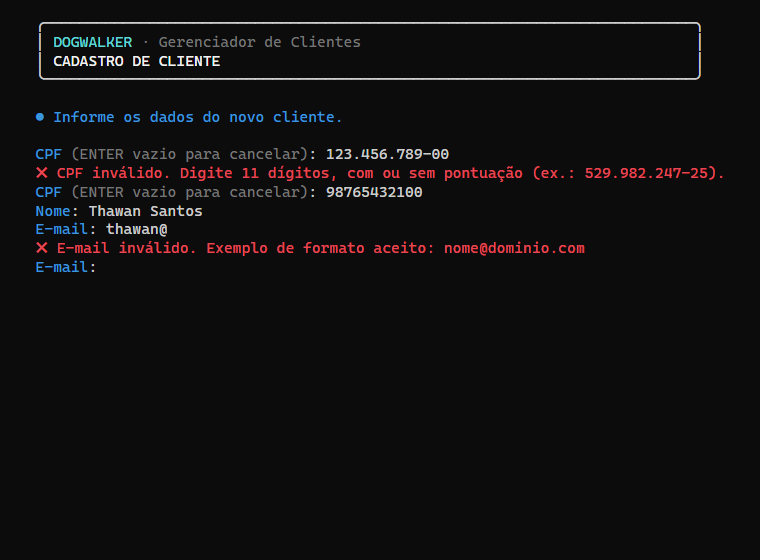

# 🐕 DogWalker — Gerenciador de Clientes em C


Sistema de linha de comando para cadastrar, listar, alterar e remover clientes
de um serviço de passeio de cães, com login e armazenamento em arquivo CSV.



---

## Sobre o projeto

O **DogWalker** nasceu como trabalho em grupo da faculdade: um gerenciador de clientes
em C com tela de login e operações de cadastro. Esta versão é uma **refatoração completa**
do código original. Ela mantém a ideia, o menu e as funcionalidades do trabalho, mas corrige
bugs graves (a alteração sobrescrevia o primeiro cliente do arquivo e a remoção não existia),
elimina riscos de *buffer overflow* e organiza o código em módulos testáveis.

O código original foi preservado em [`docs/codigo-original/`](docs/codigo-original/dogwalker_original.c),
e a análise detalhada de cada problema está em [`docs/ANALISE_CODIGO_ORIGINAL.md`](docs/ANALISE_CODIGO_ORIGINAL.md).

## Objetivo

* **Acadêmico:** praticar os fundamentos de C, como structs, ponteiros, strings, arquivos,
  alocação dinâmica e modularização.
* **Prático:** oferecer a um pequeno negócio de *dog walking* um cadastro de clientes
  simples, que roda em qualquer computador e não depende de banco de dados.

## Funcionalidades

| Funcionalidade | Descrição |
|----------------|-----------|
| 🔐 **Login** | Usuário e senha, senha mascarada com `*` (Backspace funciona), máximo de 3 tentativas |
| ➕ **Cadastro** | CPF validado (dígitos verificadores), sem duplicidade, todos os campos validados, confirmação antes de gravar |
| 📋 **Listagem** | Tabela com bordas, filtro por nome, cidade, UF, CPF (com ou sem máscara) ou e-mail, sem diferenciar acentos, e ordenação por nome ou cidade |
| ✏️ **Alteração** | Busca por CPF, mostra os dados atuais, ENTER mantém o valor, confirmação antes de gravar |
| 🗑️ **Remoção** | Busca por CPF, mostra os dados, pede confirmação e remove apenas aquele cliente |
| 💾 **Persistência** | Arquivo CSV (`data/clientes.csv`) com gravação segura via arquivo temporário |
| 🎨 **Interface** | Cores, bordas e ícones; menu com setas, atalhos por número/letra e Esc; barra de status; modo texto simples automático quando não há terminal |

## Tecnologias utilizadas

* **Linguagem C (padrão C11)**, compilada com GCC (Linux/macOS) ou MinGW-w64 (Windows)
* **Biblioteca padrão:** `stdio.h`, `stdlib.h`, `string.h`, `ctype.h`, `errno.h`, `limits.h`, `stdarg.h`
* **APIs do sistema (isoladas por `#ifdef`):** `windows.h`/`conio.h` (UTF-8 e cores no console,
  leitura de teclas, troca atômica de arquivo) e `termios.h`/`unistd.h` (leitura de teclas no Linux/macOS)
* **Interface:** sequências **ANSI** (cores, limpar tela, cursor) e caracteres **Unicode**
  (bordas e ícones), sem nenhuma biblioteca externa. Veja [`docs/INTERFACE.md`](docs/INTERFACE.md)
* **Armazenamento:** arquivo **CSV** separado por `;`, codificado em UTF-8
* **Build:** GNU Make

## Conceitos utilizados

| Conceito | Onde aparece |
|----------|--------------|
| **Structs** | `Cliente` e `ListaClientes` em [`cliente.h`](include/cliente.h) |
| **Funções e modularização** | 7 módulos com `.h` (interface) e `.c` (implementação); a parte visual isolada em `ui.c` |
| **Ponteiros** | Passagem por referência (`Cliente *`), aritmética em `dividir_campos`, ponteiros de função (`Normalizador`, `Operacao`) |
| **Funções variádicas** | `ui_erro("...%s", valor)` com `va_list`/`vprintf` e checagem de formato pelo compilador |
| **UTF-8** | `ui_largura_texto` e `ui_truncar` alinham tabelas contando colunas, não bytes |
| **Alocação dinâmica** | Vetor que cresce com `realloc` (capacidade dobra), `free` centralizado em `lista_liberar` |
| **Strings** | `fgets`, `strchr`, `strcmp`, `memmove`, `snprintf`; remoção de espaços; normalização de CPF/CEP |
| **Arquivos** | `fopen`/`fgets`/`fprintf`/`fclose` com verificação de erro, arquivo temporário e `rename` |
| **Condicionais** | `switch` do menu com `enum`, regras de validação |
| **Loops** | Menu em laço (sem recursão), repetição de perguntas até valor válido |
| **Validação de dados** | Algoritmo dos dígitos verificadores do CPF, e-mail, UF, CEP, tamanho dos campos |
| **Enums** | `ResultadoEntrada`, `ResultadoArquivo`, `OpcaoMenu`, `UiCor`, `TeclaNavegacao` |
| **Compilação condicional** | `#ifdef _WIN32` para portabilidade |
| **Testes automatizados** | [`tests/test_dogwalker.c`](tests/test_dogwalker.c), sem bibliotecas externas |

## Estrutura do projeto

```
DogWalker/
├── include/                    # Interfaces (o que cada módulo oferece)
│   ├── arquivo.h               #   leitura/gravação do CSV
│   ├── cliente.h               #   struct Cliente e lista dinâmica
│   ├── login.h                 #   autenticação
│   ├── menu.h                  #   menu principal
│   ├── terminal.h              #   leitura segura do teclado
│   ├── ui.h                    #   camada visual: cores, bordas, tabelas, menu
│   └── validacao.h             #   regras de validação dos campos
├── src/                        # Implementações
│   ├── main.c                  #   ponto de entrada: login → menu
│   ├── arquivo.c               #   CSV, gravação segura via .tmp
│   ├── cliente.c               #   adicionar, buscar por CPF, remover
│   ├── login.c                 #   tela de login (3 tentativas)
│   ├── menu.c                  #   telas de cadastro, alteração, listagem (com filtro) e remoção
│   ├── terminal.c              #   fgets seguro, senha com *, setas/Esc (Windows/Linux)
│   ├── ui.c                    #   modo rico (ANSI + Unicode) e modo simples automático
│   └── validacao.c             #   CPF, e-mail, UF, CEP, texto, conversão de inteiro
├── tests/
│   └── test_dogwalker.c        # testes automatizados (make test)
├── data/
│   ├── .gitkeep                # mantém a pasta no Git
│   └── clientes_exemplo.csv    # dados FICTÍCIOS para demonstração
├── docs/
│   ├── ANALISE_CODIGO_ORIGINAL.md  # problemas do código original e correções
│   ├── DECISOES_TECNICAS.md        # por que cada escolha foi feita
│   ├── INTERFACE.md                # alternativas avaliadas para a interface e a escolhida
│   ├── ROADMAP.md                  # próximos passos priorizados
│   ├── img/                        # capturas de tela usadas neste README
│   └── codigo-original/
│       └── dogwalker_original.c    # versão original (não compilada)
├── .vscode/                    # compilar (Ctrl+Shift+B), executar, testar e depurar (F5)
├── CHANGELOG.md                # histórico de alterações por versão
├── .gitignore
├── LICENSE
├── Makefile
└── README.md
```

## Requisitos

* Um compilador C com suporte a C11:
  * **Windows:** [MinGW-w64](https://www.mingw-w64.org/) (recomendado: pacote **WinLibs** ou **MSYS2**).
    > ⚠️ A extensão *C/C++* do VS Code oferece IntelliSense e depuração, mas **não inclui compilador**.
    > Instale o GCC separadamente, por exemplo com `winget install BrechtSanders.WinLibs.POSIX.UCRT`.
  * **Linux:** `gcc` e `make` (`sudo apt install build-essential` no Ubuntu/Debian).
  * **macOS:** `xcode-select --install`.
* **GNU Make** (opcional; também é possível compilar com um único comando `gcc`).

Confirme a instalação:

```bash
gcc --version
```

## Como compilar

### Linux / macOS

```bash
make
```

### Windows (MinGW-w64, no PowerShell ou Prompt de Comando)

```bash
mingw32-make
```

### Sem Make (qualquer sistema)

```bash
gcc -std=c11 -Wall -Wextra -Wpedantic -Iinclude src/*.c -o dogwalker
```

> No PowerShell o curinga `src/*.c` não é expandido para o gcc. Use a lista explícita:
> `gcc -std=c11 -Wall -Wextra -Iinclude src/main.c src/arquivo.c src/cliente.c src/login.c src/menu.c src/terminal.c src/ui.c src/validacao.c -o dogwalker.exe`

### No VS Code

O projeto já traz a pasta `.vscode/` configurada. Primeiro instale um compilador (veja
[Requisitos](#requisitos)) e então:

1. **Arquivo → Abrir Pasta...** e selecione a pasta `DogWalker` (a pasta do projeto, não uma pasta acima dela).
2. Instale a extensão recomendada **C/C++** (`ms-vscode.cpptools`), se o VS Code sugerir.
3. Use:

| Ação | Como |
|------|------|
| Compilar | `Ctrl+Shift+B` |
| Executar | `Ctrl+Shift+P` → **Tasks: Run Task** → **DogWalker: executar** (digite login e opções no terminal que abrir) |
| Rodar os testes | `Ctrl+Shift+P` → **Tasks: Run Test Task** |
| Depurar (breakpoints) | `F5` → **DogWalker: depurar** (abre uma janela de console para digitar) |

Erros de compilação aparecem na aba **Problemas** com link para a linha.

### Comandos do Makefile

| Comando | O que faz |
|---------|-----------|
| `make` | Compila o programa e gera `dogwalker` (`dogwalker.exe` no Windows) |
| `make run` | Compila se necessário, garante que a pasta `data/` existe e executa |
| `make test` | Compila e executa os testes automatizados; retorna erro se algum falhar |
| `make cenarios` | Executa os 36 testes de uso ponta a ponta (Windows/PowerShell) |
| `make clean` | Remove os executáveis gerados |

No Windows, troque `make` por `mingw32-make`.

## Como executar

```bash
./dogwalker
```

No Windows:

```bash
.\dogwalker.exe
```

Por padrão os dados ficam em `data/clientes.csv` (relativo à pasta de onde o programa é executado).
Para usar outro arquivo, passe o caminho como argumento:

```bash
./dogwalker data/clientes_exemplo.csv
```

**Credenciais padrão:** usuário `admin`, senha `admin`, as mesmas do trabalho original.
Para trocá-las sem recompilar, use variáveis de ambiente:

```bash
DOGWALKER_USUARIO=maria DOGWALKER_SENHA='s3nh@' ./dogwalker
```

## Como utilizar

Para começar com dados de demonstração:

```bash
cp data/clientes_exemplo.csv data/clientes.csv
```

### Atalhos de teclado

| Onde | Tecla | Ação |
|------|-------|------|
| Menu | `↑` `↓` | Move o destaque (circular) |
| Menu | `Enter` | Abre a opção destacada |
| Menu | `1`–`5` | Abre a opção direto, sem Enter |
| Menu | `C` `A` `L` `R` `S` | **C**adastrar, **A**lterar, **L**istar, **R**emover, **S**air |
| Menu | `Esc` | Encerra o programa |
| Listagem | texto + `Enter` | Filtra por nome, cidade, UF, CPF ou e-mail (acentos opcionais: "sao" encontra "São") |
| Listagem | `/n` `/c` `/o` + `Enter` | Ordena por **n**ome, por **c**idade ou volta à **o**rdem de cadastro (o filtro é mantido) |
| Listagem | `Enter` vazio | Volta ao menu |
| Senha | `Backspace` | Apaga o último caractere |
| Qualquer pergunta | `Ctrl+Z` (Windows) / `Ctrl+D` (Linux) | Encerra |

### Modo rico e modo simples

A interface escolhe o modo sozinha:

* **Modo rico:** quando o programa roda num terminal com suporte a cores (Windows 10+,
  Windows Terminal, terminal do VS Code, Linux, macOS). Usa cores, bordas Unicode e menu por setas.
* **Modo simples:** quando a saída é redirecionada (testes, `programa > log.txt`), o terminal é
  antigo, ou você define `NO_COLOR=1` ou `DOGWALKER_SIMPLES=1`. Usa texto puro, bordas ASCII
  (`+--+`) e menu por número ou letra + Enter.

```bash
DOGWALKER_SIMPLES=1 ./dogwalker
```

### Listagem com filtro



### Validação durante o cadastro



### Exemplo: alteração (ENTER mantém o valor atual)

```
  CPF (ENTER vazio para cancelar): 11144477735

  Cliente encontrado:
  ...
  Digite os novos dados. Pressione ENTER para manter o valor atual.
  (O CPF identifica o cliente e não pode ser alterado.)

  Nome [Bruno Lima]:
  E-mail [bruno.lima@example.com]: bruno@example.com
  Rua [Avenida Brasil]:
  ...
  Salvar as alterações? [s/n]: s

  ✔ Dados alterados com sucesso!
```

## Testes

### Testes automatizados

```bash
make test
```

O arquivo [`tests/test_dogwalker.c`](tests/test_dogwalker.c) verifica as regras de negócio e a persistência
sem interação humana:

* CPF: com/sem máscara, dígitos verificadores errados, sequências repetidas, letras, tamanho errado
* E-mail, UF, CEP e texto: casos válidos, inválidos, `;`, caracteres de controle e limite exato de tamanho
* Conversão da opção do menu (`"3"`, `"3abc"`, `"abc"`, números enormes)
* Lista dinâmica: adicionar, buscar, remover o elemento do meio preservando a ordem, crescer até 102 itens
* Arquivo inexistente, arquivo vazio, arquivo só com cabeçalho
* Salvar → carregar, **alterar um cliente sem afetar os outros**, **remover um cliente sem afetar os outros**
* Linhas inválidas, com campos faltando/sobrando, CPF duplicado e linha gigante (ignoradas e contadas)
* Arquivo com BOM UTF-8 e quebras de linha CRLF (salvo pelo Excel/Bloco de Notas)
* Gravação em pasta inexistente (deve retornar erro)
* 500 clientes gravados e lidos
* Filtro da listagem (maiúsculas/minúsculas, com ou sem acentos, UF, e-mail, CPF com máscara)
* Ordenação da listagem por nome e por cidade (acentos, empates e lista original intacta)
* Interface: largura de textos UTF-8 e truncamento sem cortar caracteres acentuados

Saída esperada (resumida):

```
Executando testes do DogWalker...

  [ OK ] CPF: máscara, dígitos verificadores e rejeições
  ...
  [ OK ] Interface: largura UTF-8 e truncamento sem cortar acentos

1273 verificações, 0 falha(s).
```

### Testes de cenário (Windows)

```bash
mingw32-make cenarios
```

O script [`tests/cenarios.ps1`](tests/cenarios.ps1) executa o programa com entradas
redirecionadas e simula 36 usos completos: login, cadastro com erros, filtro, ordenação, alteração, remoção,
arquivo vazio/corrompido, pasta inexistente e fim de entrada. Ele também confere no CSV que
a alteração e a remoção afetaram **só** o cliente escolhido.

### Roteiro de testes manuais

| # | Cenário | Como testar | Resultado esperado |
|---|---------|-------------|--------------------|
| 1 | Login correto | `admin` / `admin` | "Login efetuado com sucesso" e menu |
| 2 | Login incorreto | Senha errada 3 vezes | Aviso de tentativas restantes e "Acesso negado" |
| 3 | Senha mascarada | Digitar a senha e usar Backspace | Aparece um `*` por caractere; Backspace apaga o último |
| 4 | Cadastro | Opção 1 com dados válidos, confirmar `s` | "Cliente cadastrado com sucesso!" |
| 5 | Campo vazio | ENTER no Nome | "Campo obrigatório." e a pergunta se repete |
| 6 | Dado muito grande | Colar 300 caracteres no Nome | Rejeitado; o próximo campo **não** recebe o excesso |
| 7 | CPF inválido | `123.456.789-00`, `abc`, `111.111.111-11` | Mensagem de CPF inválido |
| 8 | CPF duplicado | Cadastrar um CPF já existente | "Já existe um cliente cadastrado com este CPF." |
| 9 | Cancelar cadastro | Responder `n` na confirmação | Nada é gravado |
| 10 | Listagem | Opção 3 (ou tecla `L`) | Tabela com todos os clientes e o total |
| 10b | Filtro | Na listagem, digitar `rio`, depois `529.982` | Só os clientes correspondentes; "Exibindo X de Y" |
| 10c | Navegação | `↓` `↓` `Enter` no menu; `↑` no primeiro item | Abre "Listar"; o destaque dá a volta até "Encerrar" |
| 10d | Modo simples | `DOGWALKER_SIMPLES=1` (ou `NO_COLOR=1`) | Sem cores, bordas ASCII, menu por número/letra + Enter |
| 11 | Listagem vazia | Apagar `data/clientes.csv` e listar | "Nenhum cliente cadastrado até o momento." |
| 12 | Alteração | Opção 2, mudar só o e-mail | Só o e-mail daquele cliente muda (confira os demais na listagem) |
| 13 | Alteração sem mudança | ENTER em todos os campos | "Nenhum dado foi modificado." |
| 14 | Cliente inexistente | Alterar/remover CPF válido não cadastrado | "Nenhum cliente encontrado com o CPF ..." |
| 15 | Remoção | Opção 4, confirmar `s` | Cliente some da listagem; os outros permanecem |
| 16 | Remoção cancelada | Responder `n` | "Remoção cancelada." |
| 17 | Arquivo vazio | Criar `data/clientes.csv` vazio | Funciona como lista vazia |
| 18 | Arquivo corrompido | Adicionar uma linha `lixo;lixo` ao CSV | Aviso "1 linha(s) inválida(s) ... ignoradas" |
| 19 | Vários clientes | Usar `data/clientes_exemplo.csv` e cadastrar mais | Todos listados corretamente |
| 20 | Caracteres especiais | Nome `José D'Ávila & Cia.`; Nome com `;` | Acentos aceitos; `;` recusado |
| 21 | Entrada inesperada no menu | `abc`, `9`, `1abc`, ENTER | "Opção inválida" e menu reaparece |
| 22 | Fim de entrada | Ctrl+Z+ENTER (Windows) / Ctrl+D (Linux) | Programa encerra sem travar |
| 23 | Pasta sem permissão / inexistente | `./dogwalker pasta_inexistente/x.csv` e cadastrar | Mensagem de erro de gravação e nada se perde |

## Melhorias realizadas em relação ao original

* ✅ **Alteração corrigida:** antes sobrescrevia o início do arquivo sem procurar o CPF
* ✅ **Remoção implementada** (antes era uma função vazia)
* ✅ Eliminados todos os `scanf("%s")` (*buffer overflow*) e o `fflush(stdin)` (comportamento indefinido)
* ✅ Navegação por laço em vez de recursão infinita entre menu e telas
* ✅ Validação de CPF (dígitos verificadores), e-mail, UF, CEP e tamanho dos campos; CPF único
* ✅ Formato de arquivo estruturado (CSV) e gravação segura via arquivo temporário
* ✅ Sem `system("cls")`, `conio.h` ou `sleep`, e compila em Windows, Linux e macOS
* ✅ Login com senha mascarada (`*`) e limite de tentativas
* ✅ Interface de terminal moderna (cores, bordas, menu por setas, filtro, status) sem bibliotecas,
  com modo simples automático para testes e terminais antigos
* ✅ Nenhuma variável global mutável; 7 módulos com responsabilidades claras
* ✅ Testes automatizados, Makefile, `.gitignore` protegendo dados pessoais
* ✅ Documentação de funções no estilo Doxygen e documentos de decisões técnicas

A comparação completa está em [`docs/ANALISE_CODIGO_ORIGINAL.md`](docs/ANALISE_CODIGO_ORIGINAL.md).

## Aprendizados

Este projeto demonstra:

* Leitura segura de entrada em C e por que `scanf("%s")` e `fflush(stdin)` são perigosos
* Gerenciamento de memória com `malloc`/`realloc`/`free` sem vazamentos
* Persistência em arquivo com tratamento de erro e gravação atômica
* Separação entre interface, regras de negócio e armazenamento
* Interfaces de terminal com sequências ANSI, Unicode e leitura de teclas sem bibliotecas,
  degradando com elegância quando o ambiente não suporta
* Uso de ponteiros de função para eliminar código duplicado
* Escrita de código portável com compilação condicional
* Testes automatizados sem framework externo
* Refatoração de código legado preservando o comportamento esperado

## Melhorias futuras

O backlog priorizado, com status e decisões pendentes, fica em [`docs/ROADMAP.md`](docs/ROADMAP.md),
e o histórico de cada versão em [`CHANGELOG.md`](CHANGELOG.md). Em resumo:

* Senha armazenada com **hash** (ex.: Argon2/bcrypt via libsodium) e cadastro de usuários
* Cadastro dos **cães** de cada cliente (nome, raça, porte) e agenda de passeios
* Listagem paginada e tela de detalhes do cliente
* Exportação de relatório em HTML (página estática gerada pelo próprio programa em C)
* Integração contínua (GitHub Actions) rodando `make test` em Linux e Windows
* Verificação de memória com Valgrind/AddressSanitizer na pipeline
* Migração opcional para SQLite caso o volume de dados cresça

## Autor

Projeto acadêmico desenvolvido em grupo.

### Autores do código

* **Thawan Santos**: autor e responsável pela refatoração ([GitHub](https://github.com/T-dosS))
* **Kaique Taquett**: coautor

### Integrantes do grupo

* Sabrina Fernandes
* Jhenipher
* Adilson Honda
* Paulo Bokor

## Licença

Distribuído sob a licença MIT. Veja [`LICENSE`](LICENSE).
