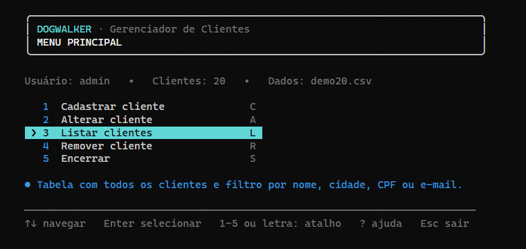
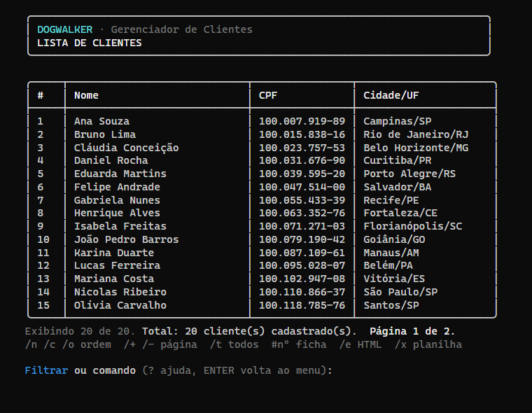
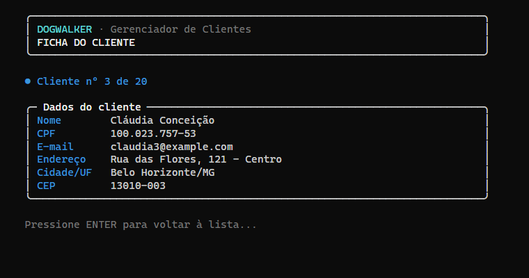
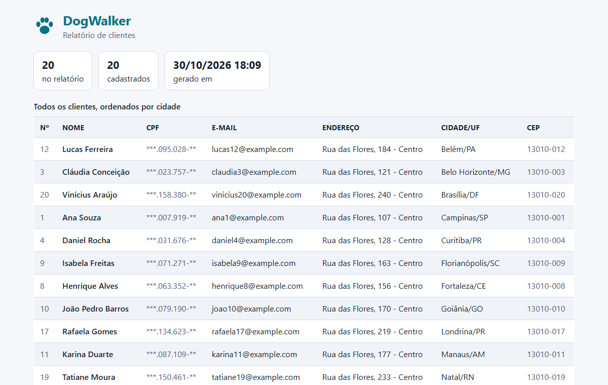
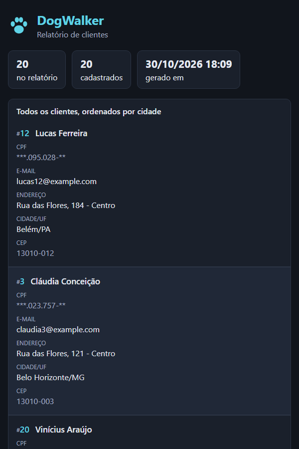
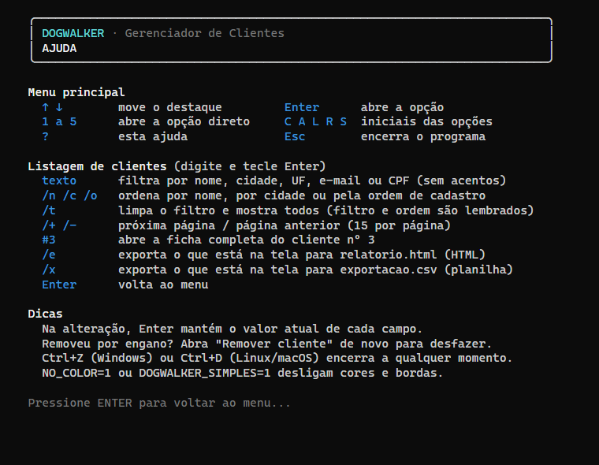
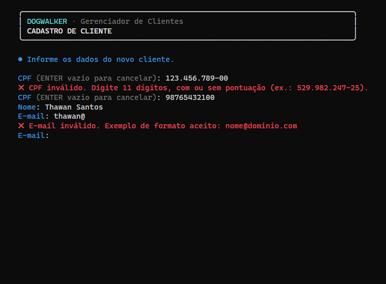

# 🐕 DogWalker: Gerenciador de Clientes em C


Sistema de linha de comando para cadastrar, consultar, alterar, remover e exportar os clientes
de um serviço de passeio de cães, com login, interface de terminal moderna e armazenamento em CSV.



---

## Sumário

[Sobre](#sobre-o-projeto) · [Funcionalidades](#funcionalidades) · [Tecnologias](#tecnologias-utilizadas) ·
[Requisitos](#requisitos) · [Instalação](#instalação) · [Configuração](#configuração) ·
[Execução](#execução) · [Como usar](#como-usar) · [Estrutura](#estrutura-do-projeto) ·
[Testes](#testes) · [Qualidade e CI](#qualidade-e-integração-contínua) ·
[Próximas melhorias](#próximas-melhorias) · [Autores](#autores)

## Sobre o projeto

O **DogWalker** nasceu como trabalho em grupo da faculdade: um gerenciador de clientes em C com
tela de login e cadastro. Passou por uma **refatoração completa** (versão 1.x), que corrigiu bugs
graves do original (a alteração sobrescrevia o primeiro cliente e a remoção não existia) e
eliminou riscos de *buffer overflow*. Depois veio o **upgrade 2.0**, que tornou o sistema 74 vezes
mais rápido para muitos clientes e trouxe paginação, ficha do cliente, exportação para relatório
HTML e planilha, análise estática e documentação de segurança.

O código original foi preservado em [`docs/codigo-original/`](docs/codigo-original/dogwalker_original.c),
com a análise de cada problema em [`docs/ANALISE_CODIGO_ORIGINAL.md`](docs/ANALISE_CODIGO_ORIGINAL.md).

## Objetivo

* **Prático:** dar a um pequeno negócio de *dog walking* um cadastro de clientes confiável, rápido
  e que roda em qualquer computador, sem instalar banco de dados nem depender de internet.
* **Acadêmico e de portfólio:** demonstrar C moderno e seguro: modularização, memória dinâmica,
  arquivos, UTF-8, portabilidade Windows/Linux/macOS, testes automatizados e análise estática.

## Funcionalidades

| Funcionalidade | Descrição |
|----------------|-----------|
| 🔐 **Login** | Senha mascarada com `*`, máximo de 3 tentativas, credenciais configuráveis |
| ➕ **Cadastro** | CPF com dígitos verificadores e sem duplicidade; e-mail, UF, CEP e tamanhos validados; confirmação antes de gravar |
| 📋 **Listagem** | Tabela com bordas, **15 por página**, filtro por nome, cidade, UF, e-mail ou CPF (acentos opcionais) e ordenação por nome ou cidade |
| 🪪 **Ficha** | `#3` na listagem abre a ficha completa do cliente nº 3, em um cartão |
| ✏️ **Alteração** | Busca por CPF; ENTER mantém o valor atual de cada campo |
| 🗑️ **Remoção** | Busca por CPF, mostra a ficha, avisa que é definitiva e pede confirmação; a última remoção pode ser **desfeita** enquanto o programa estiver aberto |
| 📄 **Relatório HTML** | `/e` exporta o que está na tela (filtro + ordem): página responsiva, tema claro/escuro, pronta para imprimir, CPF mascarado |
| 📊 **Planilha** | `/x` exporta para CSV compatível com Excel, protegido contra injeção de fórmulas |
| ❓ **Ajuda** | `?` no menu ou na listagem mostra todos os atalhos |
| 💾 **Persistência** | CSV em UTF-8 com gravação atômica: uma falha no meio nunca corrompe os dados |
| 🎨 **Interface** | Cores, bordas e ícones; setas, atalhos e Esc; barra de status; modo texto simples automático |

<table>
<tr>
<td width="50%"><br><sub>Listagem com paginação e comandos</sub></td>
<td width="50%"><br><sub>Ficha do cliente</sub></td>
</tr>
<tr>
<td width="50%"><br><sub>Relatório HTML (desktop, tema claro)</sub></td>
<td width="50%"><br><sub>Relatório HTML (celular, tema escuro)</sub></td>
</tr>
</table>

## Tecnologias utilizadas

| Camada | Tecnologia | Por quê |
|--------|------------|---------|
| Programa | **C11** + biblioteca padrão | Núcleo rápido, portátil e sem dependências |
| Sistema | `windows.h`/`conio.h` e `termios.h`/`unistd.h`, isolados por `#ifdef` | Teclado, cores no console e troca atômica de arquivo em cada sistema |
| Interface | Sequências **ANSI** + **Unicode** | Cores, bordas e menu por setas sem biblioteca (ver [`INTERFACE.md`](docs/INTERFACE.md)) |
| Relatório | **HTML5 + CSS3** gerados pelo programa | Abre em qualquer navegador, sem servidor, sem JavaScript e sem CDN |
| Dados | **CSV** (`;`, UTF-8) | Legível, abre no Excel, fácil de versionar e de fazer backup |
| Build | **GNU Make**, gcc / MinGW-w64 | `make`, `test`, `lint`, `bench`, `check` |
| Qualidade | **cppcheck**, `-fanalyzer`, `-Werror` | Análise estática e avisos tratados como erro |
| CI | **GitHub Actions** (pronto em [`docs/ci/`](docs/ci/ci.yml)) | Linux + Windows, sanitizers |

A escolha de **não** migrar para web (React, Node, PostgreSQL) agora, com riscos e um plano
em fases, está em [`docs/AVALIACAO_TECNOLOGIAS.md`](docs/AVALIACAO_TECNOLOGIAS.md).

## Requisitos

* Compilador C com suporte a C11:
  * **Windows:** MinGW-w64. Recomendado: `winget install BrechtSanders.WinLibs.POSIX.UCRT`
    (inclui gcc, `mingw32-make`, gdb e cppcheck).
    > A extensão *C/C++* do VS Code **não inclui** compilador.
  * **Linux:** `sudo apt install build-essential cppcheck` (Ubuntu/Debian).
  * **macOS:** `xcode-select --install` (e `brew install cppcheck` para o lint).
* Terminal com UTF-8. Cores e setas funcionam no Windows 10+, Windows Terminal, VS Code, Linux e macOS;
  terminais antigos usam o modo simples automaticamente.

## Instalação

```bash
git clone https://github.com/T-dosS/DogWalker.git
```

```bash
cd DogWalker
```

```bash
make
```

No Windows, use `mingw32-make` no lugar de `make`. Sem Make, compile direto:

```bash
gcc -std=c11 -O2 -Iinclude src/*.c -o dogwalker
```

> No PowerShell o curinga não é expandido; liste os arquivos:
> `gcc -std=c11 -O2 -Iinclude src/arquivo.c src/cliente.c src/exportar.c src/login.c src/main.c src/menu.c src/terminal.c src/ui.c src/validacao.c -o dogwalker.exe`

**No VS Code:** abra a pasta `DogWalker` e use `Ctrl+Shift+B` para compilar,
**Tasks: Run Task → DogWalker: executar** para rodar e `F5` para depurar.

## Configuração

| Variável de ambiente | Efeito | Padrão |
|----------------------|--------|--------|
| `DOGWALKER_USUARIO` | Usuário do login | `admin` |
| `DOGWALKER_SENHA` | Senha do login | `admin` |
| `NO_COLOR` | Qualquer valor desliga cores e bordas Unicode ([no-color.org](https://no-color.org)) | não definida |
| `DOGWALKER_SIMPLES` | `1` força o modo texto simples | não definida |

```bash
DOGWALKER_USUARIO=maria DOGWALKER_SENHA='s3nh@' ./dogwalker
```

> Troque a senha padrão em uso real. Riscos e limitações estão em [`SECURITY.md`](SECURITY.md).

## Execução

```bash
./dogwalker
```

No Windows: `.\dogwalker.exe`. Os dados ficam em `data/clientes.csv`; para usar outro arquivo, passe o caminho:

```bash
./dogwalker data/clientes_exemplo.csv
```

Relatórios e planilhas exportados são gravados **na mesma pasta do arquivo de dados**
(`data/relatorio.html` e `data/exportacao.csv`), e o `.gitignore` impede que vão para o Git.

## Como usar

Para começar com dados fictícios: `cp data/clientes_exemplo.csv data/clientes.csv`.

| Onde | Tecla / comando | Ação |
|------|-----------------|------|
| Menu | `↑` `↓` `Enter` | Navega e abre a opção |
| Menu | `1`–`5` ou `C` `A` `L` `R` `S` | Abre a opção direto |
| Menu | `?` / `Esc` | Ajuda / encerra |
| Listagem | texto + `Enter` | Filtra (nome, cidade, UF, e-mail, CPF; "sao" encontra "São") |
| Listagem | `/n` `/c` `/o` | Ordena por nome, por cidade ou pela ordem de cadastro (filtro e ordem são lembrados) |
| Listagem | `/t` | Limpa o filtro e mostra todos |
| Listagem | `/+` `/-` | Próxima página / página anterior |
| Listagem | `#3` | Ficha completa do cliente nº 3 |
| Listagem | `/e` / `/x` | Exporta o que está na tela para HTML / planilha |
| Listagem | `?` / `Enter` vazio | Ajuda / volta ao menu |
| Alteração | `Enter` vazio | Mantém o valor atual do campo |
| Qualquer lugar | `Ctrl+Z` (Windows) / `Ctrl+D` (Linux) | Encerra |



**Modo rico × modo simples:** com terminal compatível, há cores, bordas Unicode e menu por setas.
Com saída redirecionada (testes, `programa > log.txt`), terminal antigo ou `NO_COLOR`, o programa
usa texto puro e menu por número/letra + Enter, sem perder nenhuma função.



## Estrutura do projeto

```
DogWalker/
├── include/                 # Interfaces públicas de cada módulo
├── src/
│   ├── main.c               # ponto de entrada: terminal → login → menu
│   ├── menu.c               # telas: cadastro, alteração, listagem, ficha, remoção, ajuda
│   ├── cliente.c            # struct Cliente, lista dinâmica, filtro e ordenação
│   ├── validacao.c          # CPF, e-mail, UF, CEP, texto, comparação sem acentos
│   ├── arquivo.c            # CSV: carga linear (índice hash de CPF) e gravação atômica
│   ├── exportar.c           # relatório HTML5/CSS3 e planilha protegida
│   ├── terminal.c           # teclado: linhas, senha com *, setas/Esc (Windows e POSIX)
│   ├── ui.c                 # visual: cores, bordas, tabelas, cartões, menu, modo simples
│   └── login.c              # autenticação com 3 tentativas
├── tests/
│   ├── test_dogwalker.c     # 1337 verificações unitárias (make test)
│   ├── cenarios.ps1         # 56 cenários ponta a ponta no Windows (make cenarios)
│   ├── cenarios.sh          # 27 cenários ponta a ponta em shell POSIX (Linux, macOS, Git Bash)
│   └── benchmark.c          # medição de desempenho (make bench)
├── data/clientes_exemplo.csv # dados FICTÍCIOS
├── docs/
│   ├── AUDITORIA.md         # auditoria técnica 1.2 → 2.0, com prioridades
│   ├── AVALIACAO_TECNOLOGIAS.md # quais tecnologias valem a pena e plano de evolução
│   ├── DECISOES_TECNICAS.md # por que cada escolha foi feita
│   ├── INTERFACE.md         # design da interface de terminal
│   ├── ROADMAP.md           # próximos passos e decisões pendentes
│   ├── ANALISE_CODIGO_ORIGINAL.md
│   ├── ci/ci.yml            # workflow do GitHub Actions, pronto para ativar
│   ├── img/                 # capturas de tela
│   └── codigo-original/     # versão original do trabalho
├── .vscode/                 # compilar, executar, testar e depurar no VS Code
├── CHANGELOG.md · SECURITY.md · LICENSE · Makefile
└── README.md
```

## Testes

| Comando | O que valida | Resultado atual |
|---------|--------------|-----------------|
| `make test` | Regras de negócio, persistência, filtro, ordenação, exportação (escape HTML, fórmulas, máscara), UTF-8 | **1337 verificações, 0 falhas** |
| `make cenarios` | Usos completos com o programa real: login, cadastro com erros, filtro, ordenação, paginação, ficha, ajuda, exportações (conferindo o conteúdo dos arquivos), alteração e remoção (conferindo que só o cliente escolhido mudou), arquivo vazio/corrompido, pasta inexistente | **Windows:** 56 cenários (PowerShell), 0 falhas · **Linux/macOS:** 27 cenários (`sh`), 0 falhas no Git Bash |
| `make bench` | Tempo de gravar e carregar 1.000, 10.000 e 50.000 clientes | 50.000 carregados em ~0,04 s |
| `make check` | Tudo antes de publicar: build rigoroso com `-Werror`, testes, cppcheck e cenários | ✅ |

## Qualidade e integração contínua

* Compila **sem avisos** com `-Wall -Wextra -Wpedantic -Wshadow -Wformat=2 -Wconversion
  -Wsign-conversion -fanalyzer -Werror` (`make strict`).
* **cppcheck** sem achados (`make lint`). Os falsos positivos são suprimidos linha a linha, com justificativa.
* O workflow do **GitHub Actions** em [`docs/ci/ci.yml`](docs/ci/ci.yml) roda Linux (incluindo
  AddressSanitizer e UBSan) e Windows. Para ativá-lo: `gh auth refresh -h github.com -s workflow`
  e copie o arquivo para `.github/workflows/`.

## Próximas melhorias

O backlog priorizado, com o que depende de decisão, está em [`docs/ROADMAP.md`](docs/ROADMAP.md),
e o histórico de versões em [`CHANGELOG.md`](CHANGELOG.md). Em destaque:

* Ativar a integração contínua (só falta liberar o escopo `workflow` do token)
* Cadastro dos **cães** de cada cliente e telefone do tutor (mudam o modelo de dados)
* Senha com *hash* e cadastro de usuários
* Agenda de passeios, e SQLite quando houver relacionamentos (cliente → cães → passeios)

## Aprendizados

Leitura segura de entrada; memória dinâmica sem vazamentos; tabela hash de endereçamento aberto;
gravação atômica; UTF-8 na prática (largura, truncamento, comparação sem acentos); interfaces de
terminal com ANSI/Unicode; geração segura de HTML e CSV (escape, injeção de fórmulas, LGPD);
código portável; testes unitários e de ponta a ponta sem framework; análise estática; refatoração
de código legado sem regressões.

## Autores

Projeto acadêmico desenvolvido em grupo.

**Autores do código**

* **Thawan Santos**: autor e responsável pela refatoração e pelo upgrade 2.0 ([GitHub](https://github.com/T-dosS))
* **Kaique Taquett**: coautor

**Integrantes do grupo:** Sabrina Fernandes, Jhenipher, Adilson Honda e Paulo Bokor.

## Licença

Distribuído sob a licença MIT. Veja [`LICENSE`](LICENSE).
